<a href="https://diyongamage.github.io/firebreak/">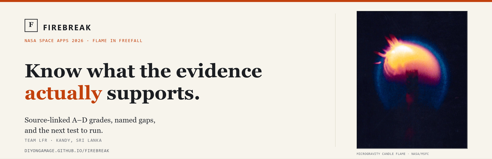</a>

# Firebreak

Source-linked, decision-grade screening for spacecraft material flammability.

**NASA Space Apps Challenge 2026** · Team LFR, Kandy, Sri Lanka
Challenge: *Flame in Freefall: SI-Powered Fire Safety Insights from Microgravity Combustion Data*

<p align="center">
  <a href="https://diyongamage.github.io/firebreak/"><b>Technical report</b></a> ·
  <a href="https://diyongamage.github.io/firebreak/?tour=1"><b>Watch the demo</b></a> ·
  <a href="#quick-start">Quick start</a> ·
  <a href="docs/validation.md">Validation</a> ·
  <a href="docs/sources.md">Sources</a> ·
  <a href="docs/credits.md">Image credits</a>
</p>

<p align="center">
  
  
  
  
  
</p>

Firebreak answers four questions for a material and cabin atmosphere: what evidence exists,
what grade that evidence supports, what uncertainty remains, and what test to run next. Every
result links to a PSI test row, an NTRS page, or a NASA standard clause. The demo runs offline
from a curated 1,170-record corpus.

For a materials engineer preparing a NASA-STD-6001 Test 1 campaign, it turns 501 pages across
nine documents into one cited dossier: the grade, the nearest tests, and the gap that would
change it.

## What it does

- Grades evidence **A/B/C/D** with a verdict and confidence — strength of evidence, not safety.
- Ranks all **11 NASA-named combustion investigations** for a chosen crew environment; all carry
  records, and only the six with experiment rows can set a grade.
- Shows a **four-role evidence court** behind every grade — Curator, Critic, Safety Officer,
  Experimentalist — generated from rules, never from a language model.
- Surfaces **contradictions** between 1-g and microgravity evidence (PMMA: 2.4 percentage points).
- Reports mission readiness per environment, including the spacesuit case it refuses to grade.
- Shows source-linked microgravity and 1-g evidence, including negative margins.
- Flags out-of-envelope conditions and missing pressure or flow data.
- Ranks material classes by evidence gaps for a selected atmosphere.
- Screens BASS-II CO₂-rise severity with one monotonic model, 80% conformal sets, and explicit
  abstention outside training support.
- Provides an optional local Cactus Needle assistant with visible tool traces.
- Exports a printable dossier; runs offline after setup.

## The evidence pipeline

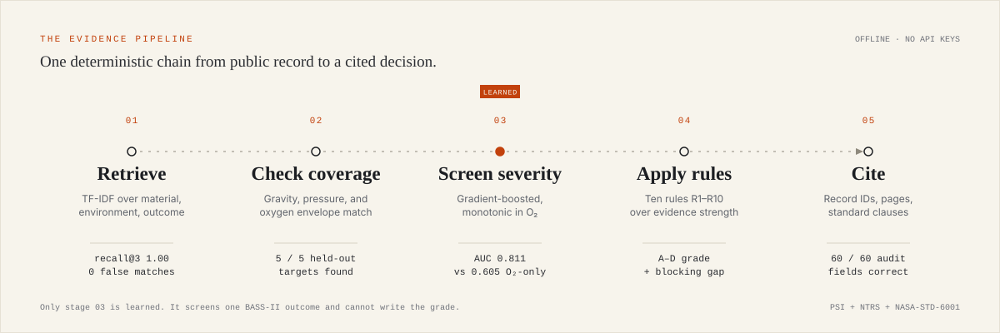

Retrieval, coverage, rules, and citation are deterministic. Exactly one stage is learned, and it
is advisory.

## Where the AI is

Retrieval is TF-IDF, coverage checks and A–D grading are deterministic rules, and one
gradient-boosted model screens BASS-II PMMA/SIBAL severity (δCO₂ > 0.5). It is monotonic in
oxygen, reports an 80% conformal prediction set, and abstains outside 13.6–22.2% O₂ instead of
extrapolating. It cannot write the grade.

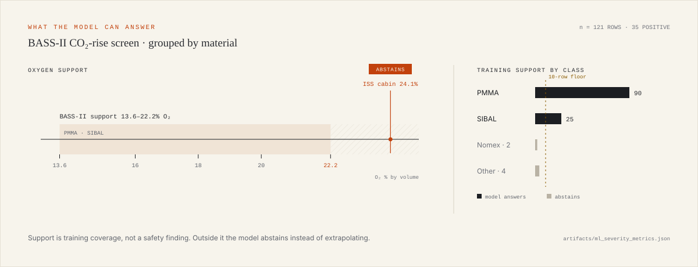

## The app

<a href="https://diyongamage.github.io/firebreak/">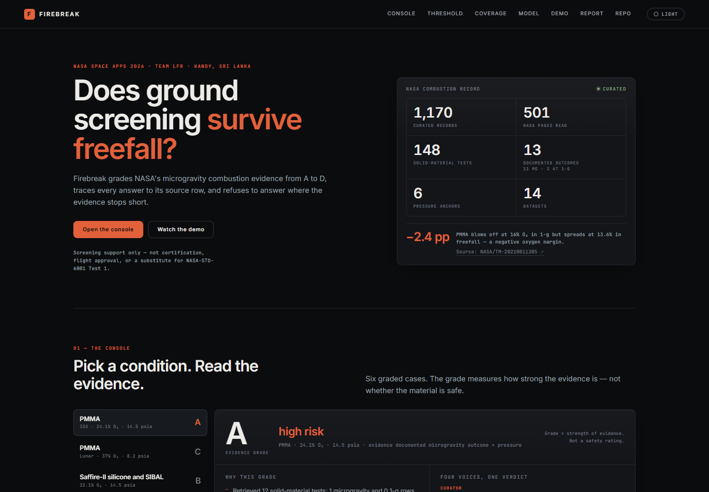</a>

| <a href="docs/screenshots/02-assessment.png">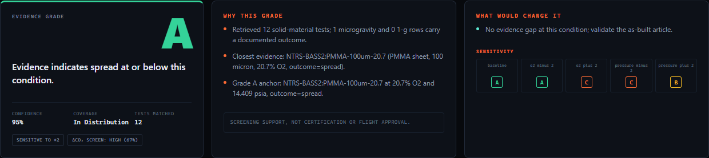</a> | <a href="docs/screenshots/03-gap-map.png">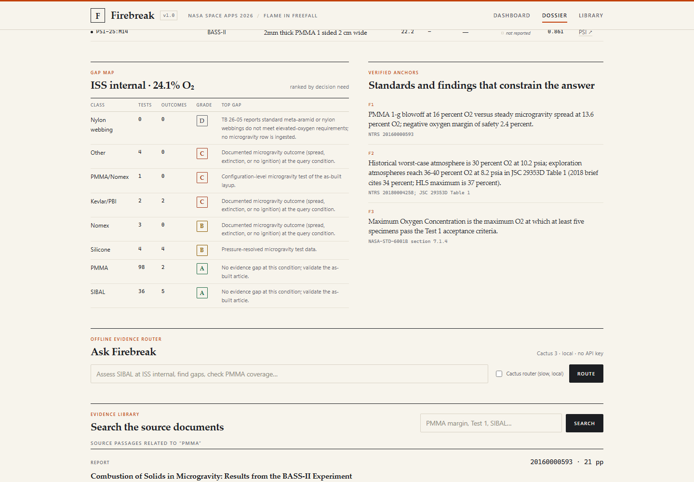</a> |
|---|---|
| **Dossier.** Grade, matched tests, and the sensitivity that would move the answer. | **Gap map.** Classes ranked by decision need, not by row count. |

| <a href="docs/screenshots/07-severity-model.png">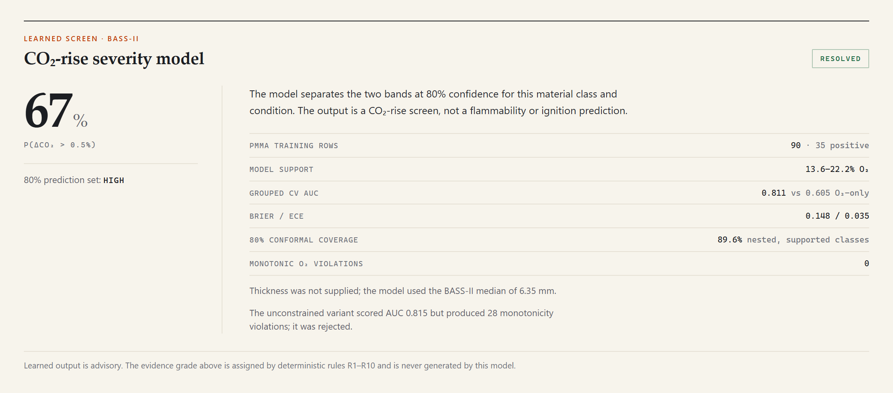</a> | <a href="docs/screenshots/04-library.png">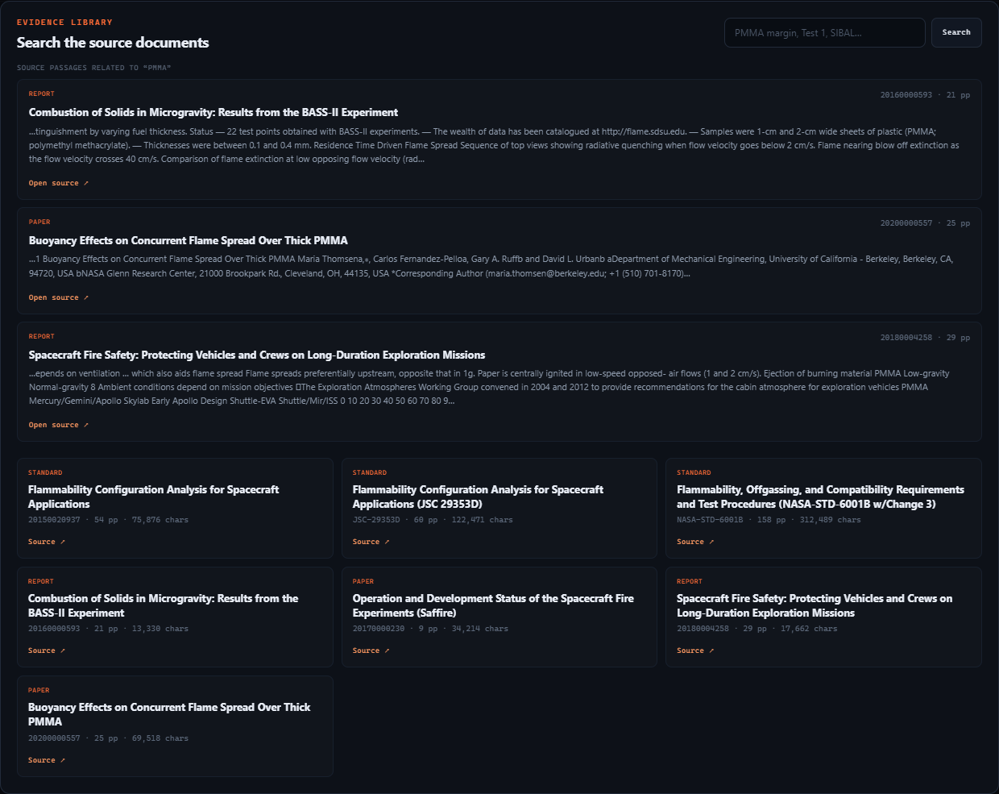</a> |
|---|---|
| **ML-3 panel.** Monotonic GBM, conformal set, explicit support region. Advisory only. | **Library.** Full-text search across nine public NASA documents (501 pages). |

## Investigations

<a href="docs/screenshots/07-investigations.png">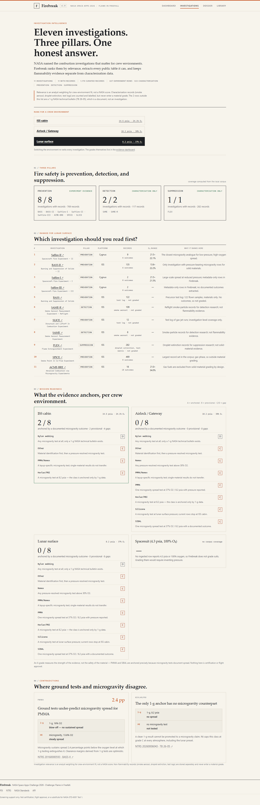</a>

NASA's challenge asks for investigations, not just materials. All eleven named investigations
now carry real PSI records: 637 experiment rows plus 533 characterisation records from SAME,
SAME-R, FLEX, BASS and SLICE. Characterisation records carry a label and are stored apart from
the experiment table, so smoke-aerosol and droplet-extinction data can show detection and
suppression coverage without ever entering a material grade.

| <a href="docs/screenshots/08-court.png">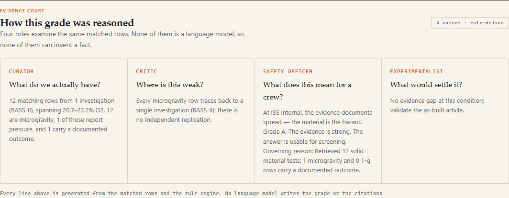</a> | <a href="docs/screenshots/11-readiness.png">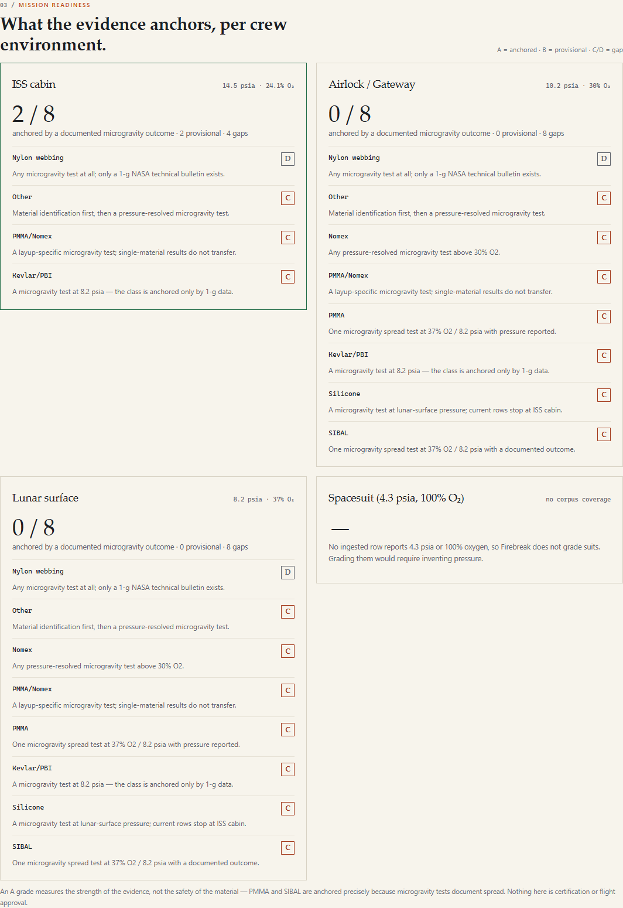</a> |
|---|---|
| **Evidence court.** Four roles, zero model-written facts. | **Readiness.** What the evidence anchors, and what it cannot. |

## Real NASA imagery

No image in this project is AI-generated. Both plates are NASA photographs, credited in
[`docs/credits.md`](docs/credits.md).

| 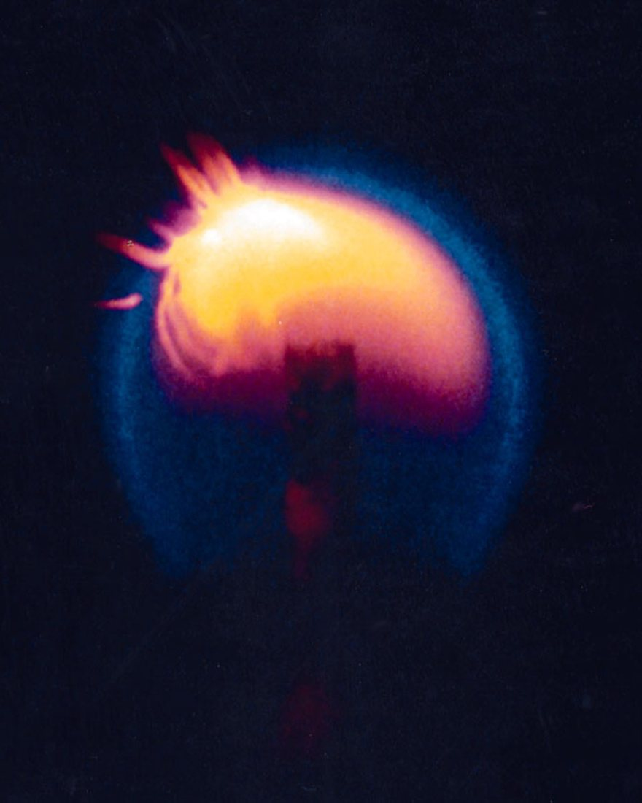 | 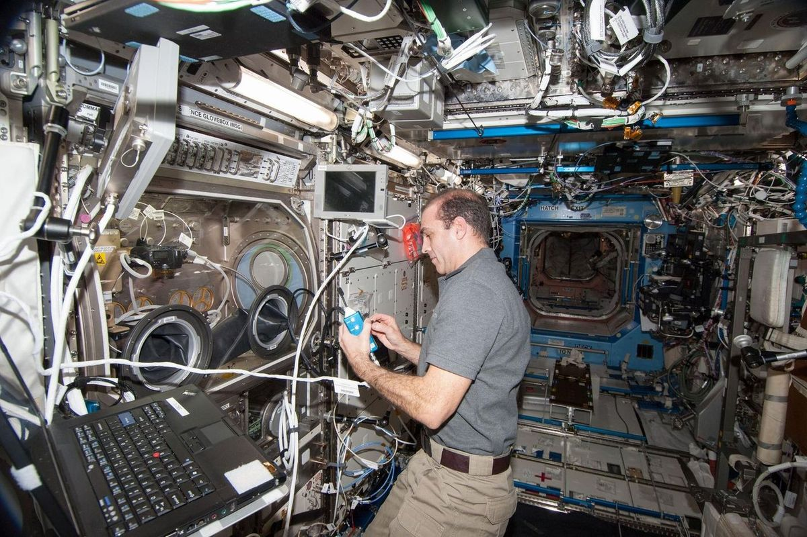 |
|---|---|
| **A candle flame in microgravity**, about 25 seconds after ignition. Candle Flames in Microgravity, NASA/MSFC, 1997 · image 9902614. | **BASS-II aboard the ISS.** Astronaut Rick Mastracchio in the Microgravity Science Glovebox, 18 February 2014. NASA/JSC · ISS038-E-053250. |

## Results

| Check | Result |
|---|---|
| Extraction audit | 60/60 fields, 30/30 rows |
| ML-1 retrieval | recall@3 1.00, false-match rate 0.00 |
| ML-2 coverage | 5/5 held-out targets found |
| ML-3 severity | AUC 0.811 vs 0.605 O₂-only; Brier 0.148; ECE 0.035 |
| 80% conformal sets | 89.6% coverage, 1.45 mean set size |
| Monotonicity | 0 O₂ violations (unconstrained variant: 28, rejected) |
| Test suite | 63 passed |
| Investigations | 11 named, 11 with records (6 experiment + 5 characterisation), 0 invented rows |
| Evidence court | 4 rule-driven voices per assessment, 0 model-written facts |
| Mission readiness | ISS 2/8 anchored · airlock 0/8 · lunar 0/8 · suit not graded |
| End-to-end | 7 API assessments, Gap Map, document search, 5 assistant routes, one live Cactus route |

## Quick start

```powershell
python -m venv .venv
.venv\Scripts\Activate.ps1
pip install -r requirements.txt
python -m uvicorn app.main:app --port 8000
```

Open http://127.0.0.1:8000. The repo ships the built SQLite corpus and cached document text,
so the demo needs no build step and no network. To rebuild from the original sources (network
required):

```powershell
python scripts\build_data.py
python scripts\build_docs.py
```

## API

| Route | Purpose |
|---|---|
| `GET /` | Evidence dashboard: corpus KPIs, ranked findings, material × atmosphere matrix |
| `GET /assess` | Query-string dossier: grade card, ledger, Gap Map, assistant |
| `GET /investigations` | Eleven investigations ranked by crew-environment relevance, pillars, readiness, contradictions |
| `GET /library` | Full-text search over the indexed NASA source documents |
| `GET /api/assess?material=PMMA&atmosphere=iss_internal` | JSON assessment, including the evidence court |
| `GET /api/investigations?environment=lunar_surface` | Investigation catalog, pillar coverage, readiness, contradictions |
| `GET /api/gap-map?atmosphere=iss_internal` | Ranked evidence gaps |
| `GET /api/stats` | Dataset and document counts |
| `GET /api/documents?q=...` | Source-document search |
| `GET /api/assistant?q=...&engine=cactus` | Assistant; Cactus is optional |
| `GET /healthz` | Health check |

The deterministic assistant fallback is the default. Cactus routing is local and slow on CPU
(~12–36 s in testing), so the UI serves a cached Cactus run and keeps live Cactus on the API.

## What Firebreak does not claim

- Screening support, **not certification, flight approval, or a replacement for
  NASA-STD-6001 Test 1**.
- Grade A requires a documented microgravity outcome under a pressure-bearing condition. Only
  the page-cited BASS-II NTRS rows currently satisfy that, so PMMA and SIBAL at ISS-internal
  conditions reach A. PSI solid rows without reported pressure cap at B rather than inventing
  a pressure.
- ML-3 predicts only BASS-II `delta_CO2 > 0.5` severity for PMMA and SIBAL, the two classes
  with at least ten training rows, and only within 13.6–22.2% O₂. It does not predict ignition
  or flame spread.
- SPICE gas-jet data is retained for the library but is not used to grade solids.
- MAPTIS is excluded because it requires authenticated access.

## Data and documentation

1,170 curated records: 637 experiment rows (148 graded solid-material tests, 487 gas-fuel
tests, 2 solid rows with unspecified material) and 533 non-graded characterisation records
(SAME 8, SAME-R 109, FLEX 282, BASS 122, SLICE 12); 9 source documents (501 pages). Primary
sources are the NASA PSI API (BASS-II, Saffire-I/II/III, ACME-BRE, SPICE, SAME, SAME-R, FLEX,
BASS, SLICE), NTRS reports (BASS-II results and TB 26-05), and NASA standards.

- [`PLAN.md`](PLAN.md) — scope, architecture, evidence rules, timeline, risks.
- [`docs/validation.md`](docs/validation.md) — audit, tests, ML gates, case studies, limitations.
- [`docs/sources.md`](docs/sources.md) — dataset and document provenance.
- [`docs/case_studies.md`](docs/case_studies.md) — generated case-study write-up.
- [`docs/submission.md`](docs/submission.md) — project-page copy, 90 s video script, checklist, offline demo.
- [`artifacts/`](artifacts) — machine-readable validation and ML metrics, plus sample dossier PDFs.

---

Photographic plates are NASA imagery used with credit; NASA does not endorse this project.
MIT licensed.
